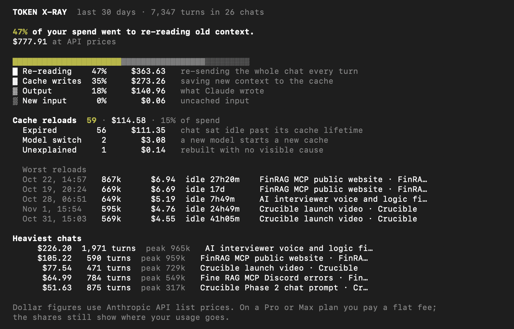

# Token X-ray

**Find and stop wasted Claude Code spend.**

Claude Code re-sends your whole conversation on every turn. Most of what you pay for (or burn through on a plan) is the model re-reading context it has already seen, and full cache reloads after a chat sits idle too long. Token X-ray reads your local Claude Code logs and shows exactly where it goes.

```bash
npx tokenxray
```



- **Share of spend on re-reading**, and the cost at API prices
- **Spend split**: re-reading, cache writes, output, new input
- **Cache reloads** by cause (expired, model switch, unexplained), with the worst ones
- **Heaviest chats**

```bash
npx tokenxray --days 7     # look back 7 days (default 30)
npx tokenxray --json       # the same numbers as JSON
```

Needs Node.js 22.18 or newer. Reads `~/.claude/projects` (or `$CLAUDE_CONFIG_DIR/projects`). **Nothing leaves your computer.**

## How the numbers are calculated

- **Turns.** Every assistant response in your logs, including subagents. Claude Code writes one response several times while it streams; each counts once, using its final token counts.
- **Prices.** Anthropic's API list prices per model ([pricing page](https://platform.claude.com/docs/en/about-claude/pricing), checked 2026-11-03), including the separate 5-minute and 1-hour cache-write rates and each model's own cache-read rate. On a Pro or Max plan you pay a flat fee, so read dollars as "what this usage is worth"; the shares hold either way.
- **Re-reading** is the cost of cache reads: context the model had already seen, sent again.
- **Cache reload.** A turn that writes at least 60% of a 20k+ token context into the cache again instead of reading it. Its cost is that cache write.
  - **Expired:** the previous turn on the same model was longer ago than the cache lifetime (5 minutes or 1 hour, from the log).
  - **Model switch:** the first turn on a model after using another, while the old cache was still alive; caches are per model. If the chat had already sat idle past the cache lifetime, the reload counts as expired, since it would have happened on any model.
  - **Unexplained:** a rewrite inside the cache lifetime with no visible cause.
  - A rewrite right after `/compact`, or when the context shrank by 30% or more, is expected and is not counted.

## Credits

The problem was found while experimenting on a fork of [Token Monitor](https://github.com/Javis603/token-monitor) (MIT) by Javis603. Token X-ray is a fresh codebase.

## License

MIT
